

  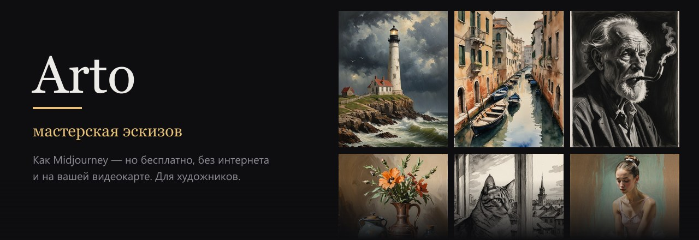

  <b>Рисуйте словами, наброском или фотографией — в технике, которую выберете сами.</b> 
  Бесплатно · без интернета · без подписок · на вашей видеокарте · по-русски

  
  
  

---

**Arto** — программа для художников, похожая на Midjourney, только всё работает у вас на компьютере.
Опишите сюжет обычными словами, выберите технику — карандаш, уголь, тушь, акварель, масло — и получите эскизы.
Дальше их можно менять словами, дорисовывать за край кадра, увеличивать, раскладывать на тона,
переносить на холст по сетке и подбирать к ним настоящие краски.

Интернет нужен только один раз — чтобы установить. Потом Arto работает полностью офлайн:
ваши картинки никуда не уходят, никаких фильтров, лимитов и платы за генерации.

## 🎨 Техники

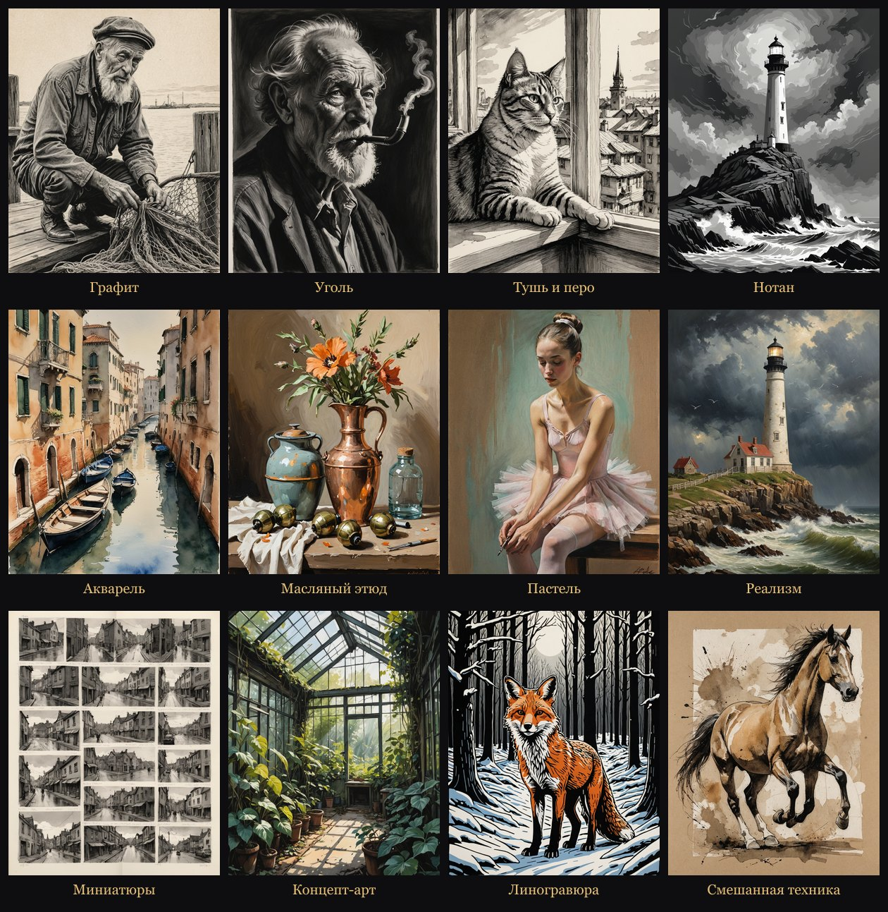

Графит, уголь, тушь и перо, акварель, масляный этюд, пастель, концепт-арт, маркеры,
нотан, листы миниатюр, линогравюра, смешанная техника, реализм — или «без стиля», строго по вашему описанию.

## ✨ Чего нет у других

Этого нет ни в Midjourney, ни в привычных онлайн-генераторах:

| | |
|---|---|
| 🎨 **Палитра и краски** | Arto находит главные цвета картинки и говорит, **какие тюбики взять и как их смешать**: номера и названия как на настоящих тюбиках — «Невская палитра» (Мастер-Класс, Белые ночи), «Малевичъ», «Гамма». Пипетка для любого цвета, список покупок, а «Мои тюбики» дают рецепты только из того, что у вас уже есть |
| 🖐 **Мой стиль** | Загрузите 15–30 своих работ — Arto **выучит вашу руку** и будет рисовать новые сюжеты так, как рисуете вы. Без настроек и терминов: одна кнопка и один ползунок |
| ♥ **Мой вкус** | Ставьте ♡ тому, что нравится, и 👎 тому, что «не то», — Arto запоминает ваш вкус и тянет новые картинки к понравившимся. Как персонализация в Midjourney, только всё хранится у вас |
| 🔁 **Обмен стилями** | Свой обученный стиль можно отправить другу одним файлом, а чужой — добавить к себе. Так собирается своя библиотека стилей |
| ⬛ **Нотан** | Разложить картинку на 2–4 тона и проверить, держится ли композиция светом и тенью |
| 📐 **Сетка для холста** | Введите размер холста в сантиметрах — Arto наложит подписанную сетку для переноса рисунка по клеткам |
| ✏️ **Рисунок по наброску** | Нарисуйте каракули прямо в Arto или сфотографируйте эскиз — получите картину, где **композиция и линии ваши** |
| 🧱 **Фактура не теряется** | После правок ИИ Arto возвращает ваши настоящие мазки везде, где ничего не менялось, — стиль не «замыливается» |
| 🇷🇺 **Понимает по-русски** | Встроенный офлайн-переводчик и «словарь художника»: лессировка, контражур, в пол-оборота, томный взгляд… |
| 🔒 **Всё у вас** | Ни облака, ни аккаунта, ни подписки. Картинки не покидают компьютер |

## 🖼 Как это выглядит

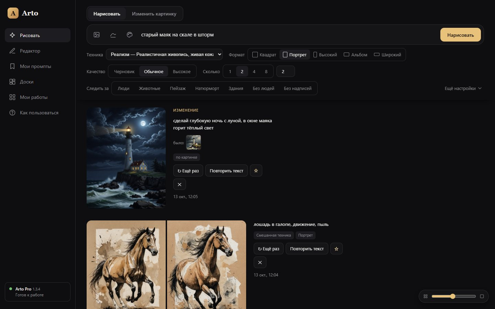

Пишете, что нарисовать, выбираете технику, формат, качество и сколько вариантов — готовые картинки появляются
в ленте с процентами и временем ожидания. Кнопки **«Следить за»** — Люди, Животные, Пейзаж, Натюрморт, Здания — делают
Arto внимательнее к типичным ошибкам: лишним пальцам, пятой лапе, кривому горизонту.

### Всё, что можно сделать с картинкой

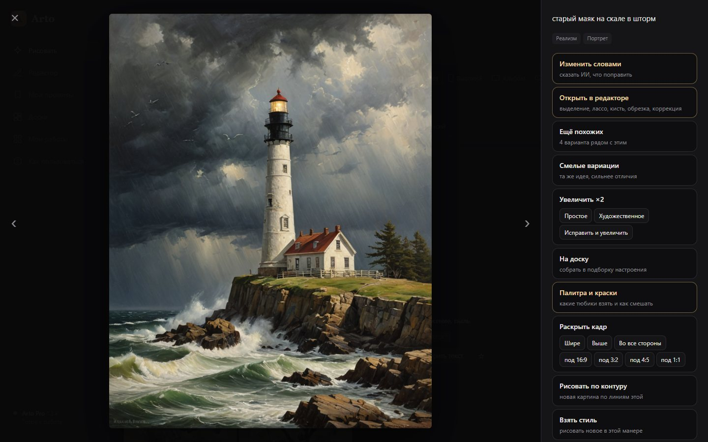

Ещё похожих и смелые вариации · увеличение ×2 (простое, художественное, с исправлением рук и лиц) ·
раскрыть кадр · рисовать по контуру · взять стиль · палитра и краски · на доску настроения.

### Изменить картинку словами

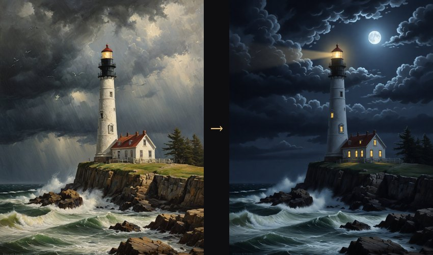

«Сделай глубокую ночь с луной, в окне маяка горит тёплый свет» — и всё остальное остаётся как было.
Можно сразу попросить 2 или 4 варианта, а ползунком «до / после» сравнить с оригиналом:

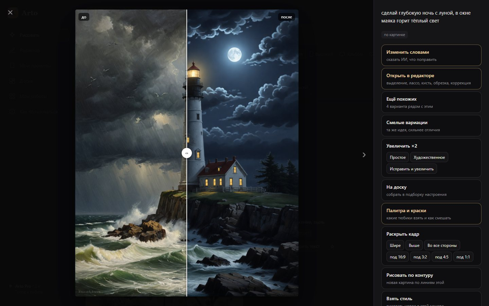

### Нарисовать по наброску или по фото

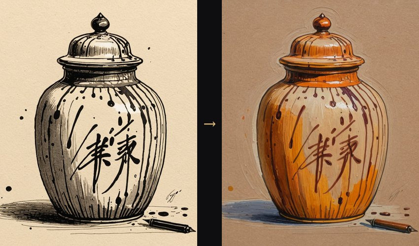

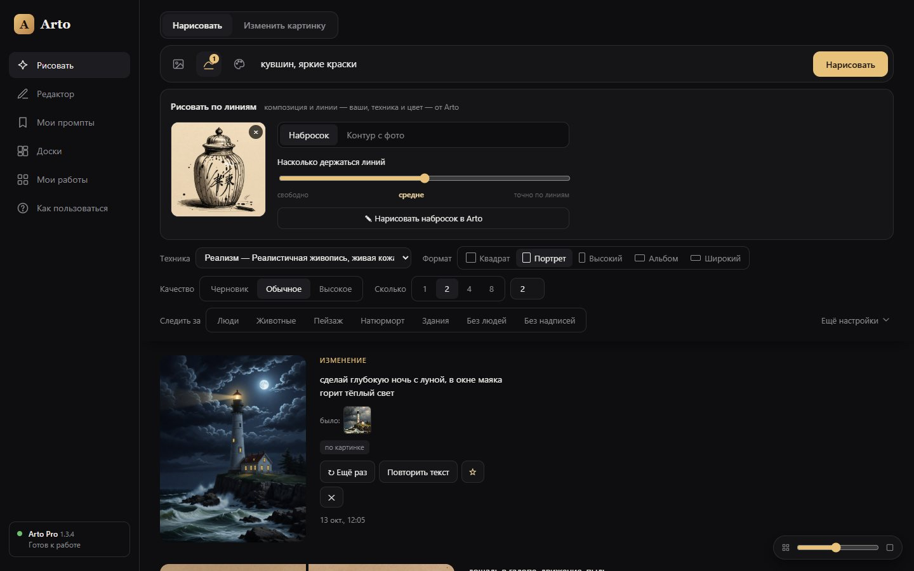

«Набросок» — Arto раскрасит и дорисует ваши линии. «Контур с фото» — возьмёт позу и композицию с фотографии,
а нарисует в выбранной технике:

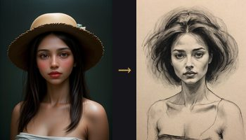

### Раскрыть кадр

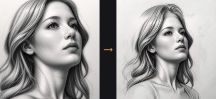

Шире, выше, во все стороны или под нужный формат (16:9, 3:2, 4:5, 1:1). Сцена продолжается за край
в той же манере, а сама картинка не меняется.

### Стиль с картинок

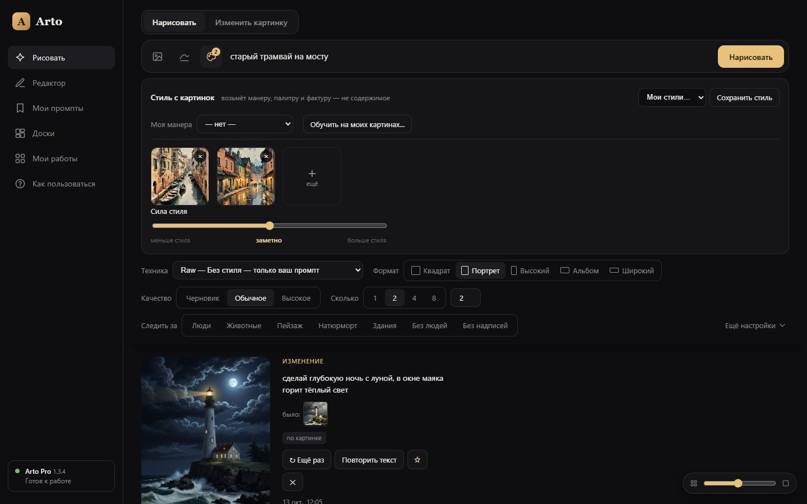

Добавьте 1–3 картинки, чья манера нравится, — Arto возьмёт мазок, палитру и фактуру, но не сюжет.
Один ползунок: меньше или больше стиля. Удачный набор можно сохранить в «Мои подборки».

### Мой стиль

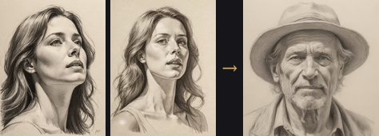

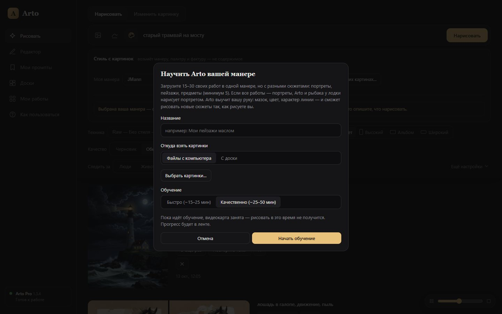

Обучение занимает 15–50 минут. Потом просто выберите свой стиль в списке и опишите, что нарисовать, —
технику, свет и фактуру он задаёт сам. Кнопка **«Поделиться стилем»** сохранит его одним файлом для друзей,
а **«Добавить стиль из файла»** добавит стиль, которым поделились с вами (стиль из Pro работает в Pro, из Lite — в Lite).

### Палитра и краски

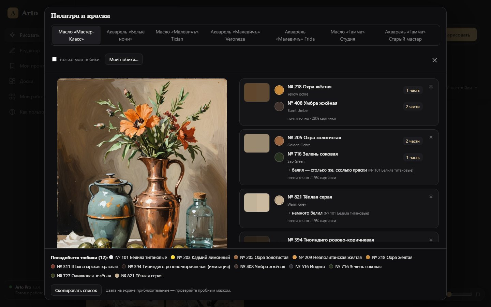

### Редактор

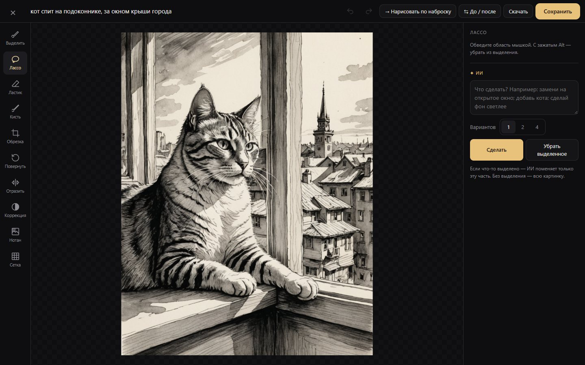

Выделение кистью и лассо, кисть, обрезка, поворот, коррекция цвета — и **ИИ по выделению**:
обведите место и напишите, что с ним сделать. Меняется только выделенное.

<table>
  <tr>
    <td width="50%">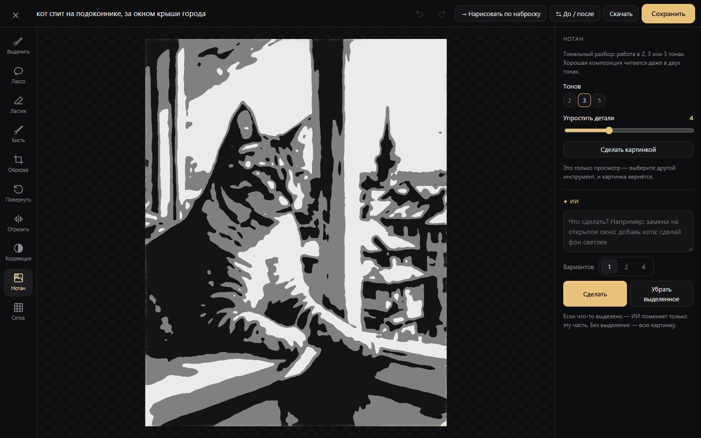
<b>Нотан</b> — 2, 3 или 4 тона
</td>
    <td width="50%">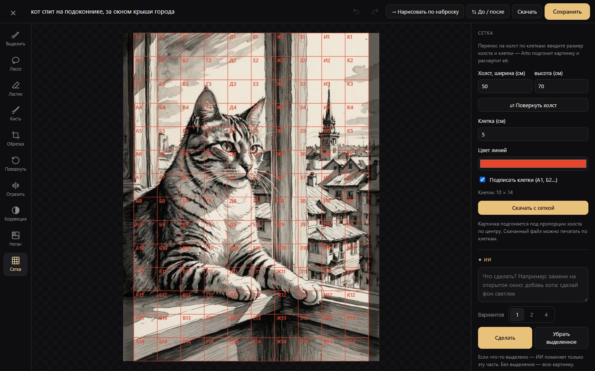
<b>Сетка</b> под размер вашего холста
</td>
  </tr>
</table>

### Ещё

- **Серии в одном стиле** — несколько строк в запросе (Shift+Enter): каждая строка — картинка, все в единой манере, как иллюстрации к одной книге.
- **Доски настроения** — собирайте свои и чужие картинки, пишите заметки, берите доску как стиль или для обучения своего стиля.
- **Мой вкус** — ♡ и 👎 у каждой картинки; с кнопкой «Мой вкус» Arto тянет новые работы к понравившимся в той же технике и уводит от неудачных.
- **Мои промпты** — сохраняйте удачные запросы звёздочкой ☆ и запускайте снова одним нажатием.
- **«Мои работы»** — все картинки с поиском, избранным и сравнением «до / после».

### Подсказки прямо в программе

<table>
  <tr>
    <td width="50%">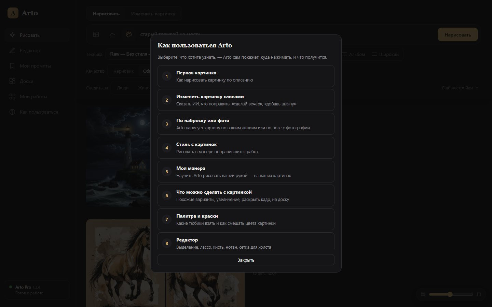</td>
    <td width="50%">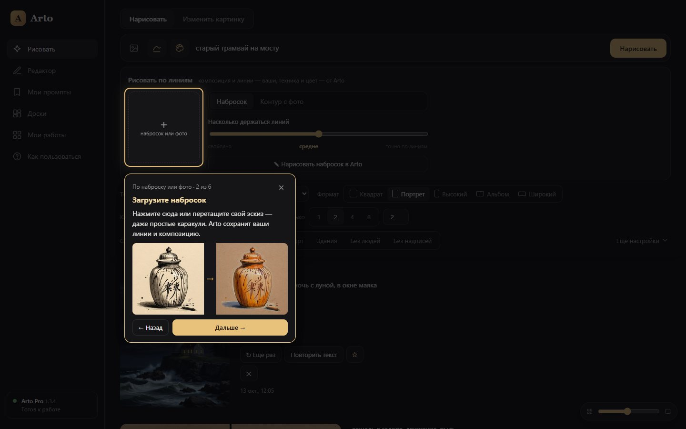</td>
  </tr>
</table>

Пункт **«Как пользоваться»**: выберите, что хотите узнать, — Arto сам подсветит, куда нажимать, и покажет, что получится.

## 📥 Установка

1. **Скачайте** архив: зелёная кнопка **Code → Download ZIP** вверху страницы (или [эта ссылка](https://github.com/YuriyKhudov/arto/archive/refs/heads/main.zip)).
2. **Распакуйте** его (правой кнопкой → «Извлечь все…») в папку, где много места. Не запускайте файлы прямо из архива.
3. Запустите **`install.bat`** и дождитесь надписи «Готово». Нужен интернет.
   Установщик сам посмотрит на вашу видеокарту и подскажет, какую версию выбрать.
4. На рабочем столе появится ярлык **Arto**. Дальше интернет не нужен.

Если у вас уже стоит ComfyUI — установщик найдёт его и докачает только недостающее.

### Какую версию выбрать

| | **Lite** | **Pro** |
|---|---|---|
| Видеокарта | NVIDIA от 6 ГБ | NVIDIA от 12 ГБ |
| Оперативная память | от 16 ГБ | от 32 ГБ |
| Место на диске | ~19 ГБ | ~29 ГБ |
| Возможности | все | все |
| Картинки | быстрее, проще | крупнее и детальнее |

Обе версии умеют одно и то же — разница только в «тяжести» моделей. Передумали — запустите `install.bat`
ещё раз и выберите другую: работы сохранятся.

### Обновления

Когда выйдет новая версия, слева внизу в Arto появится кнопка **«Обновить»**. Работы, подборки, ваши стили и настройки
сохраняются. Что нового — в [истории версий](CHANGELOG.md).

## ❓ Частые вопросы

<b>Это правда бесплатно?</b>

Да. Arto и все модели бесплатны, картинки рисует ваша видеокарта. Никаких подписок, токенов и лимитов.

<b>Где лежат мои работы?</b>

В папке программы: `data\images`. Чтобы перенести всё на другой компьютер, скопируйте папку `data`.

<b>Можно на ноутбуке / без видеокарты NVIDIA?</b>

Нужна видеокарта NVIDIA от 6 ГБ видеопамяти (ноутбучная тоже подойдёт). На AMD, Intel и Mac Arto сейчас не работает.

<b>Почему первый запуск долгий?</b>

Первый запуск за день — до минуты: двигатель загружает модели в видеокарту. Дальше всё быстро.
Чёрное окно Arto не закрывайте, пока рисуете.

<b>Что-то не работает</b>

Подробности ошибок — в файлах `data\engine.log` и `data\server.log`. Создайте
<a href="https://github.com/YuriyKhudov/arto/issues">вопрос (Issue)</a> и приложите их.

## 🛠 Для тех, кто хочет доработать

Arto легко расширять с помощью ИИ-помощников (Claude, Codex): новый инструмент редактора — это один файл
в `public/tools/`, он появляется на панели сам. Как всё устроено — в [AGENTS.md](AGENTS.md).

Внутри: Node.js без фреймворков и сборки + [ComfyUI](https://github.com/comfyanonymous/ComfyUI) как скрытый «двигатель».

## 🙏 Благодарности

Arto стоит на плечах открытых проектов и моделей:
[ComfyUI](https://github.com/comfyanonymous/ComfyUI) ·
[DreamShaper XL Turbo и DreamShaper 8 LCM](https://huggingface.co/Lykon) ·
[Qwen-Image 2.1](https://huggingface.co/Qwen/Qwen-Image-2.1) ·
[FLUX.2 klein](https://huggingface.co/black-forest-labs) ·
[IP-Adapter](https://huggingface.co/h94/IP-Adapter) ·
[ControlNet Union SDXL](https://huggingface.co/xinsir/controlnet-union-sdxl-1.0) ·
[ControlNet 1.1](https://huggingface.co/comfyanonymous/ControlNet-v1-1_fp16_safetensors) ·
[Real-ESRGAN](https://github.com/xinntao/Real-ESRGAN) ·
[NLLB-200](https://huggingface.co/facebook/nllb-200-distilled-600M) ·
[поиск лиц deepghs](https://huggingface.co/deepghs/real_face_detection) ·
[Transformers.js](https://github.com/huggingface/transformers.js).
Цвета и номера красок — с сайтов «Невской палитры», «Малевичъ» и «Гаммы».
